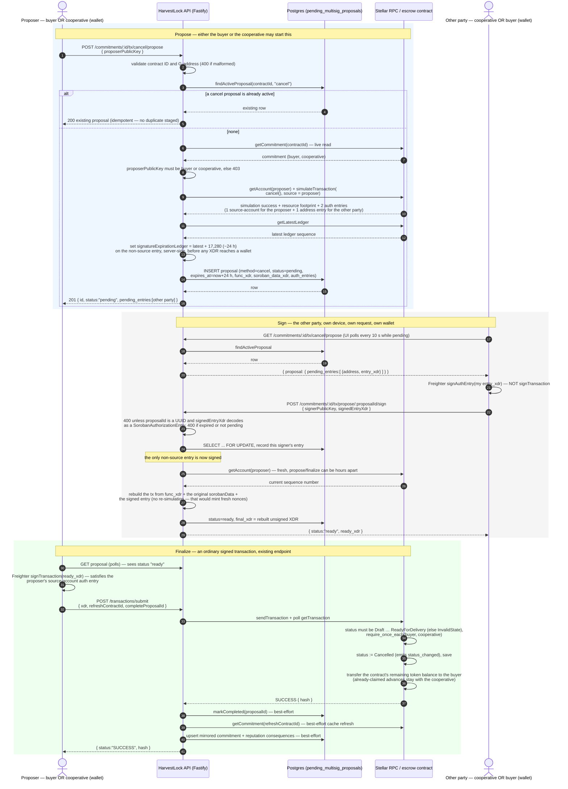

# `cancel` propose / sign / finalize — sequence diagram

How a mutual cancellation (PRD §7 "defined unwind", contract `cancel()`) is
completed when the buyer and the cooperative are on separate devices and no
script or process ever holds more than one private key. It uses the same
staged multi-party mechanism as `reassign_buyer` (three parties) and
`resolve_dispute` (three parties); `cancel` is the two-party case, so only
**one** entry is ever pending. See `../README.md`'s "Staged multi-party
signing" section for the shared design and
[`reassign-buyer-sequence.md`](./reassign-buyer-sequence.md) for the
three-party walk.

**Checked against the code, not from memory:** `src/server.ts` (routes),
`src/stellar/multiParty.ts` (propose/finalize),
`src/db/pendingMultisigProposals.ts` (Postgres staging), `src/stellar/tx.ts`
(submit), `coop-pwa/src/components/CancelSection.tsx` (the UI that drives
it), and `HarvestLock-Contracts`' `contracts/escrow/src/lib.rs` (`cancel`,
`require_once_each`) as of 26 Oct 2026. If any of those change, update this
file in the same change.

## Diagram

GitHub renders Mermaid fenced blocks natively; the same block works in the
VS Code Markdown preview (with Mermaid support) and at <https://mermaid.live>.

## Step-by-step, with where each piece lives

| # | Step | Where |
|---|---|---|
| 1 | The buyer or the cooperative proposes with `{ proposerPublicKey }`. `cancel()` takes no arguments. | `src/server.ts` `POST /commitments/:contractId/tx/cancel/propose` (`:855`) |
| 2 | An active `cancel` proposal is returned as-is (200); otherwise a new one is inserted (201). `reassign_buyer` and `resolve_dispute` proposals are separate rows and don't block it. | `findActiveProposal` (`src/db/pendingMultisigProposals.ts:71`), `createProposal` (`:34`) |
| 3 | Either party may propose — unlike `reassign_buyer`, where only the current buyer may. Anyone else gets 403, checked against a live chain read. | `src/server.ts:867-869` |
| 4 | Simulation is sourced from the proposer, so the proposer's own auth entry is `source_account` and is never handed to a wallet. Only the other party's entry is staged. | `buildMultiPartyProposal` (`src/stellar/multiParty.ts:89`) |
| 5 | `signatureExpirationLedger` is set server-side on the non-source entry (`VALID_LEDGERS_AHEAD` = 17,280 ledgers ≈ 24 h), because Freighter's `signAuthEntry` takes no expiration argument. | `src/stellar/multiParty.ts:87` |
| 6 | The row stores the function XDR, the original `sorobanData` and the entries; TTL is 24 h. | `MULTISIG_PROPOSAL_TTL_MS` (`src/server.ts:239`) |
| 7 | The other party's UI polls `GET .../cancel/propose` every 10 s while the proposal is pending; the response is `{ proposal: … \| null }`. | `src/server.ts:893`, `CancelSection.tsx` |
| 8 | The other party signs their own `entry_xdr` with `signAuthEntry` and posts it to the method-agnostic sign route. | `POST .../tx/propose/:proposalId/sign` (`src/server.ts:1004`) |
| 9 | Signing is a locked read-modify-write (`SELECT … FOR UPDATE`); a wrong signer or a repeat signature is rejected (400). | `signProposalEntry` (`src/db/pendingMultisigProposals.ts:102`) |
| 10 | With the single pending entry signed, the API rebuilds the transaction without re-simulating and marks the proposal `ready`. | `finalizeMultiPartyProposal` (`src/stellar/multiParty.ts:140`), `markReady` (`src/db/pendingMultisigProposals.ts:139`) |
| 11 | The proposer signs `ready_xdr` classically and submits with `completeProposalId`; on success the proposal is marked `completed`. | `POST /transactions/submit` (`src/server.ts:1068`), `markCompleted` (`src/db/pendingMultisigProposals.ts:143`) |
| 12 | On-chain: both parties' auth is verified, status becomes `Cancelled`, and the remaining escrow balance goes back to the buyer. | `cancel` (`lib.rs:1591`), `require_once_each` (`lib.rs:1873`) |

## Edge cases and checks (all enforced in code, not just documented)

- **Who may propose:** the buyer or the cooperative. The warehouse
  operator and third parties get 403.
- **Idempotent propose:** proposing again while a `cancel` proposal is
  active returns the existing one, whichever party asks.
- **Reachable states:** `Draft`, `Locked`, `Advance1Released`,
  `CheckpointPassed`, `Advance2Released`, `ReadyForDelivery`. From
  `Delivered` onward `settle` is the path, and `cancel` fails with the
  contract's `InvalidState` at simulation (propose) time. A `Disputed`
  commitment can't be cancelled either: resolve the dispute first, then
  cancel (see [`dispute-sequence.md`](./dispute-sequence.md)).
- **What moves:** only the contract's *remaining* balance, to the buyer,
  using the same balance-based transfer as `settle`. Advances the
  cooperative already claimed are not clawed back ("no penalty"). If
  nothing was ever locked, the balance is zero and no transfer happens.
- **Wrong signer / double sign:** 400. The signer must have an unsigned
  entry on *this* proposal.
- **Expiry:** proposals expire after 24 h (`expires_at`), and signing an
  expired one is rejected with "propose a fresh one". The staged auth entry
  carries the matching ~24 h `signatureExpirationLedger`.
- **Single-device shortcut:** `cancel` is also in the generic no-arg set
  (`POST .../tx/cancel`), which only helps when one process can sign as
  both parties. Signing the same envelope once per wallet fails on
  submission (`tx_bad_auth_extra`), which is why the staged flow exists.
- **Failure surfaces:** a simulation failure at propose time surfaces the
  real contract error. The Postgres side effects after a successful submit
  are best-effort and logged; they never mask a transaction that landed.
