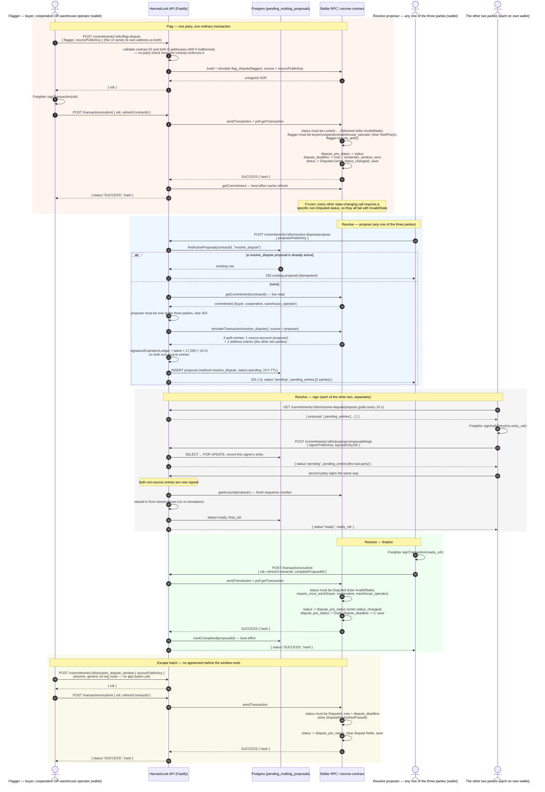

# `flag_dispute` / `resolve_dispute` — sequence diagram

How a commitment is frozen by a dispute and then resumed (PRD's must-have
"dispute flagging with defined escalation", contract `flag_dispute()`,
`resolve_dispute()` and `expire_dispute_window()`). The two halves are
deliberately different shapes:

- **Flagging is unilateral and single-signer.** Any one of the buyer, the
  cooperative or the warehouse operator signs one ordinary transaction.
- **Resolving is unanimous.** All three parties must authorize it, so it
  uses the same staged propose / sign / finalize mechanism as `cancel` and
  `reassign_buyer` (see `../README.md`'s "Staged multi-party signing",
  [`cancel-sequence.md`](./cancel-sequence.md) and
  [`reassign-buyer-sequence.md`](./reassign-buyer-sequence.md)). If the
  parties never agree, anyone may end the freeze once the dispute window
  has passed.

Neither path decides *who was right*: both resume paths restore exactly the
status the commitment had when it was flagged. If the off-chain outcome is
"unwind the deal", the parties resolve the dispute and then call `cancel`.

**Checked against the code, not from memory:** `src/server.ts` (routes),
`src/stellar/multiParty.ts` (propose/finalize),
`src/db/pendingMultisigProposals.ts` (Postgres staging), `src/stellar/tx.ts`
(build/submit), `coop-pwa/src/components/DisputeSection.tsx` (the UI,
identical in `buyer-app`), and `HarvestLock-Contracts`'
`contracts/escrow/src/lib.rs` (`flag_dispute`, `resolve_dispute`,
`expire_dispute_window`, `require_once_each`) as of 26 Oct 2026. If any of
those change, update this file in the same change.

## Diagram

GitHub renders Mermaid fenced blocks natively; the same block works in the
VS Code Markdown preview (with Mermaid support) and at <https://mermaid.live>.

## Step-by-step, with where each piece lives

| # | Step | Where |
|---|---|---|
| 1 | A party builds `flag_dispute(flagger)` through its own route, because it takes an argument and can't use the generic no-arg route. The UI passes its connected wallet as both `flagger` and `sourcePublicKey`. | `POST .../tx/flag-dispute` (`src/server.ts:677`), `DisputeSection.tsx` `handleFlag` |
| 2 | The API only checks that both addresses are well-formed. Whether `flagger` is a party is enforced by the contract's `NotAParty` error. | `src/server.ts:667-676` (comment), `lib.rs:1692` |
| 3 | The flagger signs and submits an ordinary transaction. No staging is needed, because only the flagger's own auth is required. | `POST /transactions/submit` (`src/server.ts:1068`) |
| 4 | On-chain, the current status is saved as `dispute_pre_status`, `dispute_deadline` is set to now + `remainder_window_secs`, and the status becomes `Disputed`. | `flag_dispute` (`lib.rs:1692`) |
| 5 | Any one of the three parties proposes `resolve_dispute`. Anyone else gets 403, checked against a live chain read. | `POST .../tx/resolve-dispute/propose` (`src/server.ts:957`, check at `:970-978`) |
| 6 | Simulating from the proposer yields two non-source entries (the other two parties), staged with the same 24 h TTL and `signatureExpirationLedger` as `cancel`. | `buildMultiPartyProposal` (`src/stellar/multiParty.ts:89`), `MULTISIG_PROPOSAL_TTL_MS` (`src/server.ts:239`) |
| 7 | The other two parties poll, sign their own entry with `signAuthEntry`, and post it to the shared sign route. | `GET .../resolve-dispute/propose` (`src/server.ts:998`), `POST .../tx/propose/:proposalId/sign` (`:1004`) |
| 8 | When the second signature lands, the API rebuilds the transaction and marks the proposal `ready`. | `finalizeMultiPartyProposal` (`src/stellar/multiParty.ts:140`), `markReady` (`src/db/pendingMultisigProposals.ts:139`) |
| 9 | The proposer finalizes through `/transactions/submit` with `completeProposalId`. | `src/server.ts:1068`, `markCompleted` (`src/db/pendingMultisigProposals.ts:143`) |
| 10 | On-chain, all three parties' auth is verified and the exact pre-dispute status is restored. | `resolve_dispute` (`lib.rs:1731`), `require_once_each` (`lib.rs:1873`) |
| 11 | If there is no agreement, anyone can call `expire_dispute_window` after `dispute_deadline` through the generic no-arg route. | `POST .../tx/:method` (`src/server.ts:588`), `expire_dispute_window` (`lib.rs:1764`) |

## Edge cases and checks (all enforced in code, not just documented)

- **Who may flag:** the buyer, the cooperative or the warehouse operator.
  Anyone else fails on-chain with `NotAParty`.
- **When it can be flagged:** `Locked`, `Advance1Released`,
  `CheckpointPassed`, `Advance2Released`, `ReadyForDelivery`, `Delivered`.
  Not `Draft` (nothing escrowed), not a terminal status, and not
  `Disputed` again (`InvalidState`).
- **What the freeze blocks:** every other state-changing call (`settle`,
  `cancel`, `release_advance_*`, `expire_remainder_window`, …), because none
  of them accepts `Disputed` as a valid status.
- **Known limitation:** other absolute deadlines (claim windows,
  `remainder_deadline`, `delivery_deadline`, `fx_shortfall_deadline`) keep
  running during a dispute. If one passes, the matching `claim_*` /
  `expire_*` / `reclaim_*` becomes callable as soon as the dispute ends.
  This is documented in `lib.rs`'s `flag_dispute` comment and left open on
  purpose.
- **Who may propose resolving:** any one of the three parties (403
  otherwise). Proposing again while one is active returns the existing
  proposal.
- **Unanimous, not majority:** `resolve_dispute` needs all three parties'
  auth no matter who proposed. `require_once_each` asks once per distinct
  address, so if two roles were the same address, that address signs once.
- **Deadline boundaries:** `resolve_dispute` has no deadline check and works
  at any time while `Disputed`. `expire_dispute_window` requires
  `now > dispute_deadline`, so in the deadline second itself only
  `resolve_dispute` works, and there is never a second where neither does.
- **No arbitration:** both resume paths restore `dispute_pre_status`. They
  can't move the commitment to a different status such as `Cancelled`.
- **Wrong signer / double sign / expiry:** same rules as the other staged
  proposals: 400 for a signer without an unsigned entry, and expired
  proposals must be proposed again.
- **UI gap:** no app has a button for `expire_dispute_window` yet. It can
  only be built through `POST .../tx/expire_dispute_window`.
